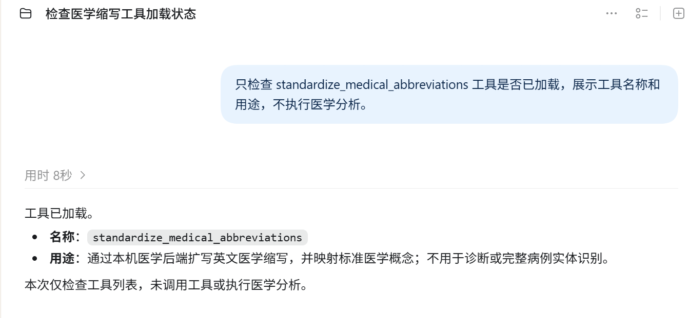
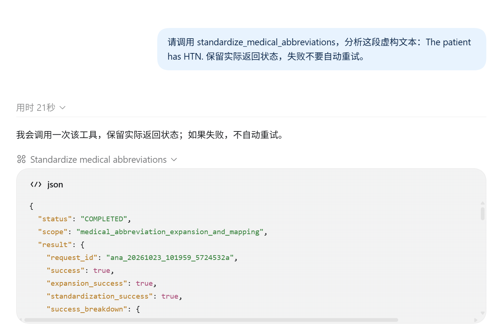
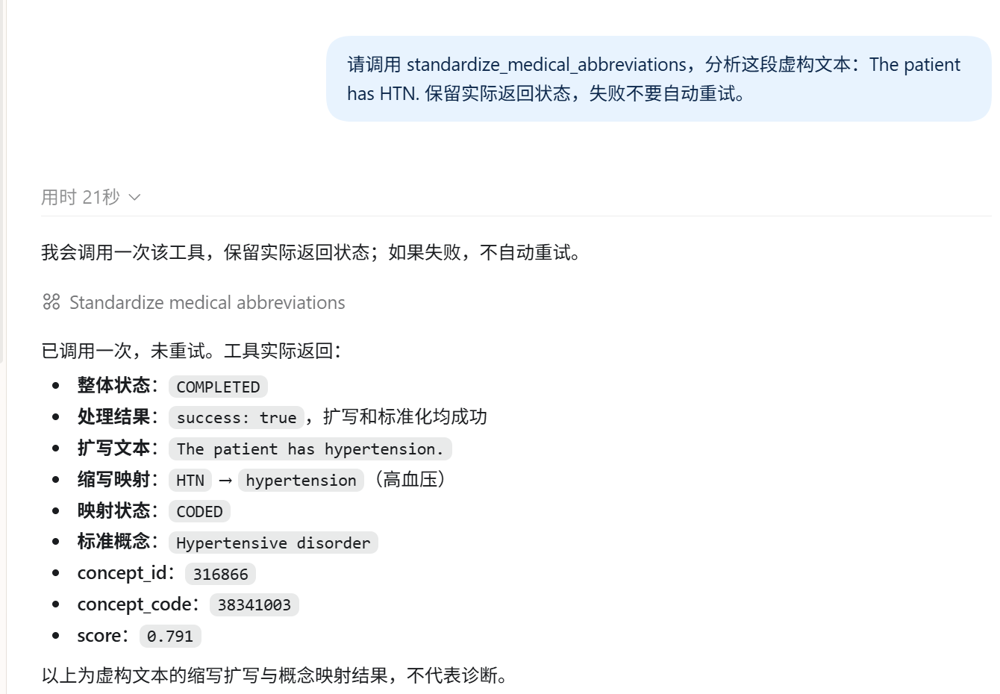
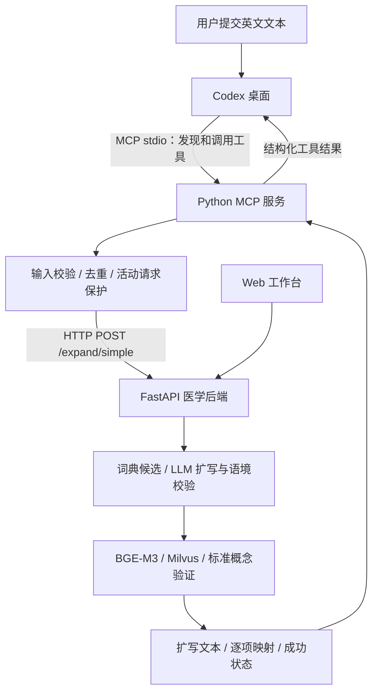

<div align="center">


# Medical-Terminology-Standardization&MCP

**在 AI 对话中调用医学术语工具，完成英文医学缩写扩写与标准概念映射。**

Codex 桌面 · MCP 标准协议 · Web 分析工作台 · BGE-M3 / Milvus · 可复核的结构化结果


</div>

## 项目介绍

本项目基于 [Medical-Terminology-Standardization](https://github.com/LI-opera/Medical-Terminology-Standardization)，将已有医学处理能力封装为 **MCP（Model Context Protocol，模型上下文协议）工具**。AI 客户端通过标准协议发现并调用 `standardize_medical_abbreviations`，接入层再请求现有 `POST /expand/simple`，返回扩写文本、逐项映射状态及标准医学概念。

对使用者来说，只需在 Codex 中提出分析要求；对系统来说，医学处理仍由原平台执行，MCP 负责工具声明、参数校验、请求控制和结构化结果传递。Web 工作台继续提供单句分析、Benchmark、错误归因与候选词典审核。

本仓库是独立的 **医学平台 + MCP** 案例，包含后端、前端及 MCP 服务源码。与 [飞书接入案例](https://github.com/LI-opera/Medical-Terminology-Standardization-Platform-feishu)共用医学处理思路，本版本入口为 AI 客户端，不需要飞书应用凭证。

## 从一条对话开始

1. 启动医学 API 和已有术语库，确认模型配置可用。
2. 在 Codex 配置中注册本项目 MCP 服务。
3. 在对话中提出：`请调用 standardize_medical_abbreviations，分析这段虚构文本：The patient has HTN.`
4. Codex 发出工具调用，MCP 接入层检查输入、并发与重复请求。
5. 医学后端执行扩写和概念映射，结果经 MCP 返回给 Codex 展示。

### 已完成的真实示例

输入：

> The patient has HTN.

实际扩写结果：

> The patient has hypertension.

| 缩写 | 扩写 | 对应标准术语 | 后端状态 |
| --- | --- | --- | --- |
| HTN | hypertension | Hypertensive disorder | CODED |
| RA | Rheumatoid Arthritis | Rheumatoid arthritis | CODED |

HTN 已通过 Codex 当前对话中的原生 MCP 工具调用验证；RA 通过本机 SDK 客户端与生产 MCP 服务验证。它们是虚构文本的真实调用结果，不能视为医学准确率评估。详细记录见 [真实演示与验证边界](integrations/mcp/LIVE_DEMO.md)。

## 效果展示

### 原平台 Web 工作台

<table>
<tr>
<td width="50%"><b>单句医学缩写分析</b><br/></td>
<td width="50%"><b>批量评估与结果复盘</b><br/></td>
</tr>
</table>

### MCP 与 Codex 演示

以下真实截图依次展示工具已加载、实际 MCP 调用及 HTN 分析结果。点击图片可查看原图。

<table>
<tr><th width="33%">① 工具接入</th><th width="33%">② 发起分析</th><th width="33%">③ 分析结果</th></tr>
<tr>
<td width="33%" valign="top"><a href="docs/images/mcp/01-tool-setup.png"></a></td>
<td width="33%" valign="top"><a href="docs/images/mcp/02-tool-call.png"></a></td>
<td width="33%" valign="top"><a href="docs/images/mcp/03-analysis-result.png"></a></td>
</tr>
</table>

## 核心能力

| 层级 | 实现 |
| --- | --- |
| AI 工具入口 | 官方 Python MCP SDK 2.3.0，本机 stdio 通信；已验证 Codex 桌面接入 |
| 医学缩写扩写 | 词典候选、LLM fallback、上下文 coverage 校验、确定性文本替换 |
| 标准概念映射 | BGE-M3 + Milvus 检索，候选验证和必要的重检索；术语覆盖取决于导入数据 |
| 请求控制 | 文本校验、SQLite 摘要去重、共享状态库内的活动请求租期，无等待队列 |
| 异常处理 | 总超时、响应大小与结构校验，不自动重跑结果未确认的请求 |
| 可复核输出 | 保留 expanded_text、mappings、mapping_states 和各成功标志，不补造概念编码 |
| Web 工作台 | 分析、Benchmark、错误归因、fallback 候选人工审核 |

默认最多 4,000 字符、HTTP 总超时 180 秒、响应上限 2 MiB。MCP 仅访问配置的本机回环 HTTP 地址，不接受工具参数传入 URL，不跟随重定向，不使用系统代理。

### 如何理解状态

| 状态 | 含义 |
| --- | --- |
| `COMPLETED` | 已收到格式有效的后端响应；仍须查看医学结果中的成功标志 |
| `CODED` | 对应缩写已映射到标准概念 |
| `WITHHELD` / `NOT_EXPANDED` / `ABSTAIN` | 暂不编码、未扩写或放弃判断，保留不确定性 |
| `BUSY` | 活动请求或保护期仍在，未新增后端分析 |
| `DUPLICATE` | 相同文本近期已有结果，请查看原工具输出 |
| `OUTCOME_UNKNOWN` | 未取得可确认结果，先排查后端，不能假定请求未执行 |

成功请求的同文本保护为 10 分钟，未确认请求为 24 小时。去重库只记录摘要、状态和时间，不缓存病例正文或结果；这意味着客户端丢失结果后不能依靠本地结果缓存重新获取。租期、取消和网络故障下不提供端到端“恰好一次”承诺。

## 系统架构



MCP 是 AI 客户端与工具之间的通信层；HTTP 是工具与医学后端之间的接口。客户端模型负责选择工具和呈现结果，原医学后端负责领域处理。MCP 不会自动启动后端，也不向外开放新的网页端口。

## 快速开始

以下为 Windows PowerShell 示例。准备 Python 3.12；医学后端需已有 Milvus 术语集合和有效模型配置。首次依赖、模型下载需要联网，真实分析可能产生模型调用费用。

### 1. 获取项目

```powershell
git clone https://github.com/LI-opera/Medical-Terminology-Standardization-MCP.git
Set-Location Medical-Terminology-Standardization-MCP
```

### 2. 准备医学后端

已有医学平台时，直接复用 API 与术语库，例如 `http://127.0.0.1:8001`，无需重建。

新环境按 [后端准备指南](docs/MCP_SETUP.md#准备医学后端) 配置。仓库保留 Docker Compose 和 5,000 条 SNOMED 示例数据；示例数据不保证覆盖上面演示中的全部概念，完整 SNOMED CT / RxNorm 需准备有权使用的数据。**初始化脚本会删除同名集合，仅能用于确认可重建的演示库。**

### 3. 创建 MCP 独立环境

```powershell
py -3.12 -m venv integrations/mcp/.venv
.\integrations\mcp\.venv\Scripts\python.exe -m pip install -r integrations/mcp/requirements-lock.txt
Copy-Item integrations/mcp/.env.example integrations/mcp/.env
```

在 `integrations/mcp/.env` 填写实际 API 地址。Docker Compose 默认对外端口为 8000，原开发机使用 8001；不要填写 `/app` 后缀：

```dotenv
MEDICAL_API_BASE_URL=http://127.0.0.1:8001
MEDICAL_TIMEOUT_SECONDS=180
MEDICAL_MAX_TEXT_CHARS=4000
```

该环境不安装医学模型依赖，也不需要飞书凭证。Windows 完整版本快照见 `requirements-lock.txt`；其他系统从 `requirements.txt` 安装并重新验证。

### 4. 先做离线验证

```powershell
.\integrations\mcp\.venv\Scripts\python.exe -m integrations.mcp.server check
.\integrations\mcp\.venv\Scripts\python.exe -m unittest integrations.mcp.tests.test_mcp -v
```

检查配置和隔离测试不会调用真实医学 API 或付费模型。测试覆盖 SDK 当前/legacy 模式与真实 stdio 子进程协议交互。

### 5. 接入 Codex 桌面

将 [配置模板](integrations/mcp/codex-config.example.toml) 中的 `command`、`cwd` 改为你电脑上的绝对路径，然后合并进 Codex `config.toml`，保留原有设置。默认位置是 `~/.codex/config.toml`。

```toml
[mcp_servers.medical_terminology]
command = 'C:\Projects\Medical-Terminology-Standardization-MCP\integrations\mcp\.venv\Scripts\python.exe'
args = ['-m', 'integrations.mcp.server', 'run']
cwd = 'C:\Projects\Medical-Terminology-Standardization-MCP'
startup_timeout_sec = 20
tool_timeout_sec = 240
enabled = true
enabled_tools = ['standardize_medical_abbreviations']
default_tools_approval_mode = 'prompt'

[mcp_servers.medical_terminology.env]
PYTHONUTF8 = '1'
```

保存后重启 Codex，先检查工具是否已加载，再用虚构文本调用。不要另开终端重复启动同一 MCP 服务。详细操作见 [接入与运行指南](docs/MCP_SETUP.md)。

### 6. 停止

将 Codex 配置中的该服务设置为 `enabled = false` 并重启客户端。医学 API 独立运行：手动启动的终端用 `Ctrl+C` 停止；由本仓库 Compose 启动的服务可执行 `docker compose stop`，保留数据卷。停止 MCP 不等于停止医学后端。

## 验证范围

| 内容 | 已有证据 |
| --- | --- |
| 输入、状态、去重、超时、取消与异常 | 7 个隔离测试方法，含多个异常子场景 |
| MCP 协议 | 官方 SDK 内存调用及 stdio 子进程握手、工具发现、调用 |
| 实际后端链路 | RA 虚构病例经 SDK 客户端调用成功 |
| Codex 原生工具调用 | HTN 虚构病例扩写和概念映射成功 |
| 截图 | 已补充 Codex 工具加载、实际调用与 HTN 结果截图 |
| 医学准确率 / 多用户 / 公网部署 | 未据上述示例作出验证或承诺 |

`/health` 仅表示 API 在线，不能证明模型和术语库可用。后端退出会导致工具无法分析；本版本不提供进程自动保活。离线测试、真实调用和医学效果评估是不同验证层次。

## 技术栈与目录

| 部分 | 技术 |
| --- | --- |
| MCP 接入 | Python、官方 MCP SDK 2.3.0、stdio、httpx、SQLite |
| 医学后端 | FastAPI、Uvicorn、Pydantic、LangChain / DeepSeek |
| 检索与映射 | sentence-transformers / BGE-M3、Milvus、SNOMED CT / RxNorm |
| Web | 原生 JavaScript、HTML、CSS |
| 工程 | Docker Compose、unittest、pytest、GitHub Actions |

```text
├─ integrations/mcp/     # MCP 服务、HTTP 适配、状态保护、测试、配置模板
├─ backend/              # 医学 API、扩写与映射、评估逻辑
├─ frontend/             # Web 工作台
├─ docs/MCP_SETUP.md     # 接入与启动指南
├─ docs/images/mcp/      # 三张真实演示截图及维护说明
├─ examples/benchmarks/  # 示例评估输入
├─ Dockerfile
└─ docker-compose.yml
```

`backend/graph/` 保留原平台实验实现，当前 API 主入口不经过该实验流程。

## 数据与使用范围

当前能力为英文医学缩写扩写与概念映射，不覆盖整份病例所有实体，不提供诊断或治疗建议。文件处理、连续追问、远程 HTTP MCP 与多用户认证不在当前版本内。

仓库不包含真实密钥、本机 `.env`、运行日志、状态库、虚拟环境、完整术语库或模型权重。MCP 状态库不保存正文，但 AI 客户端、医学后端及模型服务有各自的数据处理与日志策略。

参考：[原医学平台](https://github.com/LI-opera/Medical-Terminology-Standardization) · [飞书案例](https://github.com/LI-opera/Medical-Terminology-Standardization-Platform-feishu) · [Python MCP SDK](https://py.sdk.modelcontextprotocol.io/) · [Codex MCP 配置](https://developers.openai.com/codex/mcp/)。

当前未指定开源许可证。术语数据和模型分别遵循各自的许可及使用条件。
